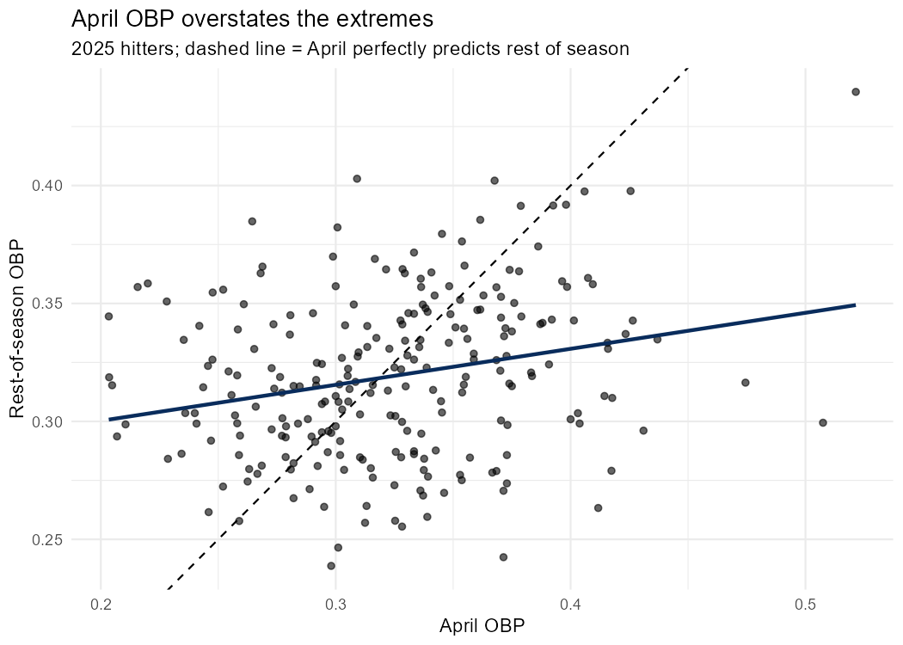
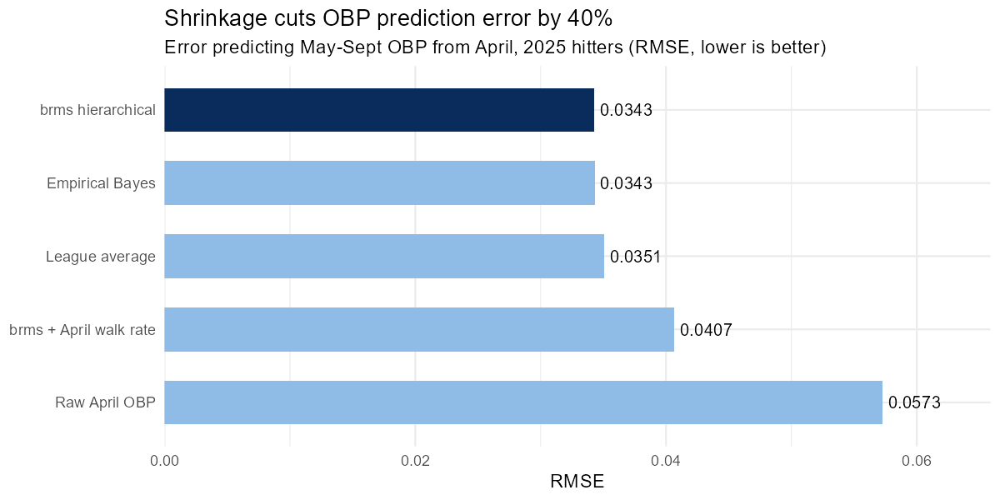
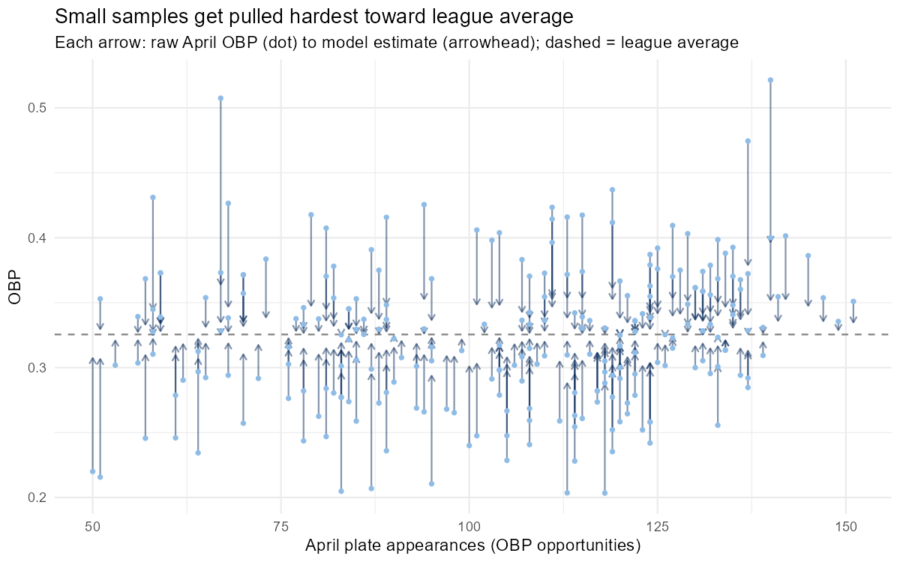
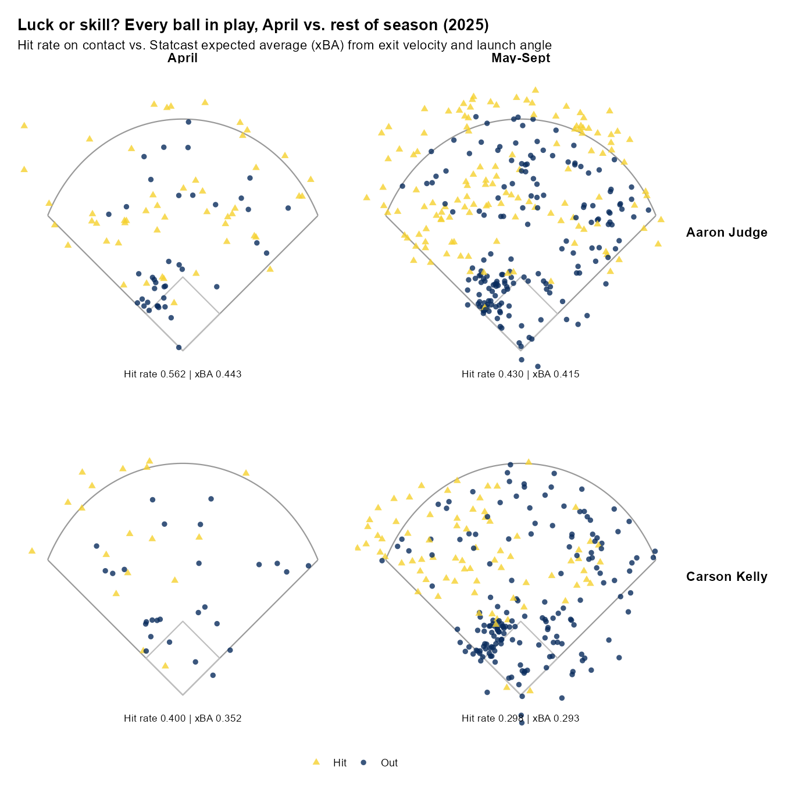
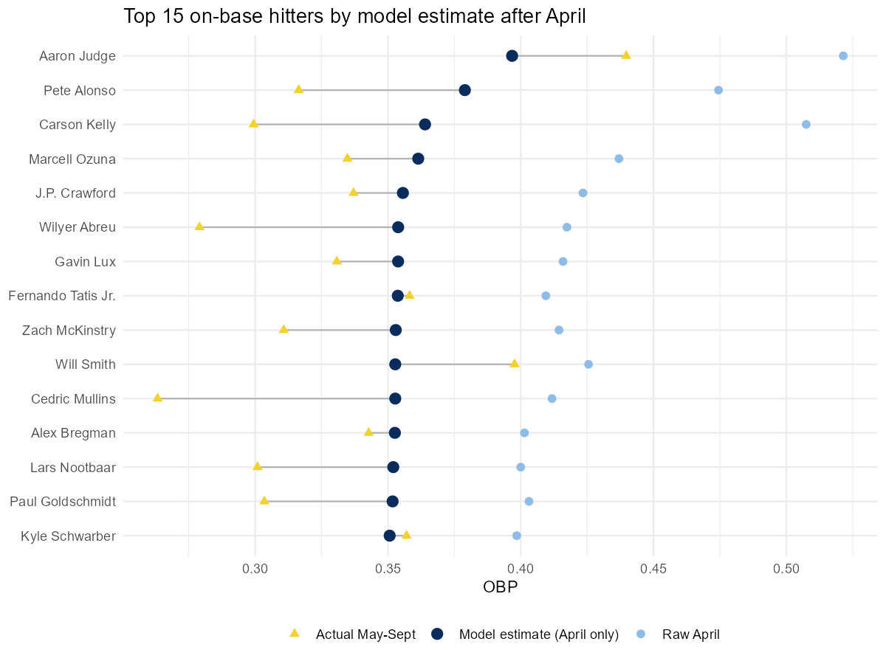

# How Much Should We Trust Early-Season OBP?

**A Bayesian shrinkage model for separating real on-base skill from April noise**

*Clayton Steinocher · Information Science, University of South Florida · [claysteinocher@gmail.com / https://www.linkedin.com/in/clayton-steinocher/]*

---

## Summary

A Bayesian hierarchical model that pulls each hitter's April on-base percentage toward the league average **cut the error in predicting his May–September OBP by 40%**, compared with taking his April OBP at face value (RMSE 0.034 vs. 0.057 across 243 hitters in 2025). The model's estimate was closer than raw April for **68% of individual hitters**.

The bigger lesson: one month of OBP carries very little signal. The model treats every hitter's April as if he had also logged about **250 additional league-average plate appearances**, more than any hitter actually had in April.

## The question

*Moneyball* made on-base percentage the poster child for undervalued skill. But OBP is also one of the slowest stats to settle: a hitter can post a .450 April on luck alone. If a front office wants to act on early-season OBP (a call-up, a lineup change, a trade target), how much of that number should it believe?

## Data

- **Source:** Baseball-Reference via the `baseballr` R package
- **April split:** March 18 – April 30, 2025
- **Rest of season:** May 1 – September 28, 2025
- **Sample:** 243 hitters with at least 50 OBP opportunities in April and 200 afterward
- **OBP** = (H + BB + HBP) / (AB + BB + HBP + SF), computed from components and checked against Baseball-Reference's published values

## A first look: April overstates the extremes

Regressing rest-of-season OBP on April OBP gives a slope of **0.15**. Only about 15% of a hitter's April gap from league average carried into the rest of the season. Pete Alonso's .474 April became a .316 rest of the way.

## Method

Each approach uses **only April data** to estimate a hitter's true OBP, then is scored against what actually happened from May through September.

| Approach | Idea |
| --- | --- |
| Raw April OBP | Take April at face value |
| League average | Ignore April; predict .326 for everyone |
| Empirical Bayes | Fit a Beta prior to the league's April OBPs; blend each hitter toward it based on his sample size |
| **brms hierarchical** | Binomial model with a random effect per hitter, fit in Stan; the data decide how hard to pull toward average |
| brms + April walk rate | Same model, adding April walk rate as a predictor |

## Results

| Approach | RMSE | Error cut vs. raw April |
| --- | --- | --- |
| brms hierarchical | 0.0343 | 40% |
| Empirical Bayes | 0.0343 | 40% |
| League average | 0.0351 | 39% |
| brms + April walk rate | 0.0407 | 29% |
| Raw April OBP | 0.0573 | — |

In plain terms, the model's typical miss is about 34 points of OBP; raw April misses by about 57.

Three takeaways:

1. **Shrinkage works, and two independent methods agree.** The simple empirical Bayes estimate and the full Stan model land on the same error, which is good evidence the result isn't an artifact of one method.
2. **April is mostly noise.** Predicting league average for everyone gets almost the same accuracy. The model's edge is knowing *how much* to trust each hitter's sample, not finding hidden signal.
3. **Adding walk rate made things worse, and the reason matters.** In exploration, April walk rate correlated with rest-of-season OBP slightly better than April OBP itself (0.26 vs. 0.24). But walks are part of OBP, so the April walk rate shares April OBP's noise. The model learned a partly circular relationship and under-shrank high-walk hitters. A useful predictor has to come from *outside* the sample, such as last season's numbers.

Every arrow runs from a hitter's raw April OBP to the model's estimate. Even hitters with 140+ April plate appearances get pulled most of the way back, because 140 is small next to a prior worth 250.

## Three hitters

These three were chosen from the model's largest corrections to show its range: one false hot start, one false cold start, and the case where it was too cautious. They were picked to illustrate, not to flatter the model; the third is a failure mode.

**Carson Kelly: the mirage.** Kelly posted a .507 OBP in April over just 67 opportunities, and the model made its single largest correction here, discounting him to .364. He finished May–September at .299. Raw April missed by more than 200 points; the model's miss was about a third as large.

**Ramón Laureano: the false alarm.** Laureano opened at .216 over just 51 opportunities, the model's largest upward correction. It said .307, close to average. He hit .357 the rest of the way. A team reading raw April would have benched a productive hitter.

**Aaron Judge: where the model is too cautious.** Judge's .521 April was real skill, not luck. The model pulled him to .397; he hit .440 afterward. The model still beat raw April, but it treated a true superstar like everyone else. This is the clearest argument for the next step below.

## Luck or skill? A spatial look at the best and worst calls

To see why the model was right about Kelly and wrong about Judge, I mapped every ball each of them put in play. Statcast records where a batted ball lands as pixel coordinates on a field diagram. I converted those into feet from home plate, which gives each ball a real location and spray angle. I then compared each player's actual hit rate on contact with Statcast's expected batting average (xBA): how often contact with that exit velocity and launch angle usually becomes a hit.

| Player | Period | Balls in play | Hit rate | xBA | Luck gap | Avg exit velo | Hard-hit % |
| --- | --- | --- | --- | --- | --- | --- | --- |
| Aaron Judge | April | 89 | .562 | .443 | +.119 | 95.5 | 57% |
| Aaron Judge | May–Sept | 298 | .430 | .415 | +.015 | 95.3 | 59% |
| Carson Kelly | April | 45 | .400 | .352 | +.048 | 93.9 | 60% |
| Carson Kelly | May–Sept | 248 | .298 | .293 | +.006 | 87.9 | 37% |

I expected Kelly's April to look like luck and Judge's to look like skill. The data said something more useful:

- **Both were lucky in April.** Judge's hits actually outran his contact quality by more than Kelly's did (+.119 vs. +.048). By May–September, both luck gaps had nearly disappeared. Luck is the part of a hot start that doesn't last.
- **The difference was what sat underneath.** Judge's contact quality held steady: 95.5 mph average exit velocity in April, 95.3 afterward, and an xBA of .443 that is elite on its own. Kelly's collapsed: from 93.9 mph to 87.9, and his hard-hit rate from 60% to 37%.
- **The lesson for the model.** The luck gap says how much of a hot start to discount; contact quality says what's left once you do. Kelly's April hard contact came on only 45 balls in play, so it was a small sample too. Contact-quality data stabilizes faster than OBP, which makes it a natural input for the next version of this model.

## The Moneyball list

Ranking hitters by the model's estimate is the "who truly gets on base" list. Here the honest result is a tie: **53% of the model's top 15 finished May–September above league average, the same rate as the top 15 by raw April.** The model's value is in overall accuracy and in not overreacting, rather than in identifying elite on-base hitters from April alone. Doing that well needs more information, which is the next step.

## How a team could use this

- **Small-sample decisions:** evaluating a call-up, a reliever's first month, or a hitter returning from injury without overreacting to 50–100 plate appearances.
- **Reading slumps and hot streaks:** putting a number on how much an April line should move a hitter's expected performance.
- **A template for other stats:** the same model applies to any success-out-of-attempts rate (strikeout rate, walk rate, BABIP), each with its own prior strength.

## Limitations and next steps

- **Add prior-season data.** Using 2024 OBP or walk rate as a predictor would give the model information from outside the sample, fix the over-shrinking of established stars like Judge, and avoid the circularity problem from the walk-rate model.
- **Use plate-discipline and contact-quality inputs.** Statcast chase rate, exit velocity, and xBA stabilize faster than OBP and aren't mechanically part of it. The spatial section shows why contact quality matters.
- **One season, one split.** Repeating the analysis across several seasons and cutoff dates would show how stable the 250-PA prior is.
- **Survivorship.** Requiring 200 rest-of-season opportunities excludes hitters who were benched or demoted after poor starts.

## Reproduce it

Requires R 4.5, `tidyverse`, `baseballr`, and `brms` (run here with the `cmdstanr` backend).

| Script | What it does |
| --- | --- |
| `day1_get_data.R` | Pulls the April and rest-of-season splits; saves `obp_2025.csv` |
| `day2_explore_baseline.R` | Exploration and baseline errors |
| `day3_models.R` | Fits empirical Bayes and both brms models; saves `obp_2025_preds.csv` |
| `day4_evaluate.R` | Charts and player-level comparisons |
| `day5_spatial.R` | Statcast spray charts and luck-vs-skill table for Kelly and Judge |
